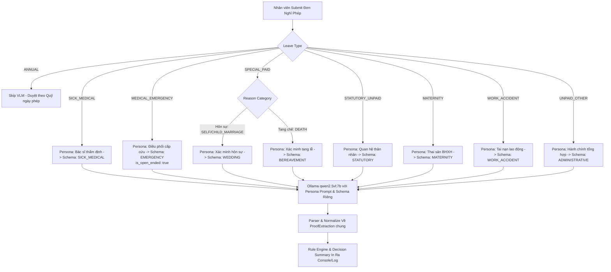

# Kế hoạch Toàn diện: Persona-Specific JSON Schema & Decision Tree cho VLM

> **Bối cảnh & Vấn đề**:
> - Trước đây: 1 schema chung 18 trường cho mọi loại nghỉ phép → VLM bị quá tải thông tin, không tập trung vào logic đặc thù, dễ sinh hallucination hoặc cảnh báo sai lệch.
> - Cấp cứu y tế (`MEDICAL_EMERGENCY`) bị gộp chung với Nghỉ ốm (`SICK_MEDICAL`): thực tế cấp cứu đột xuất **chưa xác định được ngày đi làm lại** (`recommended_to_date` = null, cần quy trình tạm duyệt / bổ sung giấy ra viện sau).
> - Sự kiện gia đình (`SPECIAL_PAID`) gộp Hôn sự và Tang lễ vào chung, khiến logic kiểm tra quan hệ thân nhân và ngày diễn ra sự kiện bị lẫn lộn.

---

## 1. Bảng phân rã Persona & Decision Tree chi tiết

| Nhóm | Leave Type | Reason Category | Persona VLM | Schema Key | Đặc thù mấu chốt |
|---|---|---|---|---|---|
| **1A. Nghỉ ốm thường** | `SICK_MEDICAL` | `PERSONAL` | 🩺 Bác sĩ kiểm định hồ sơ y tế | `SICK_MEDICAL` | Bắt buộc có đủ ngày bắt đầu, ngày kết thúc (`recommended_to_date`) và số ngày bác sĩ cho nghỉ. |
| **1B. Cấp cứu khẩn** | `MEDICAL_EMERGENCY` | `PERSONAL` | 🚑 Điều phối viên hồ sơ cấp cứu | `EMERGENCY` | **Chưa xác định ngày đi làm lại**: `discharge_date` có thể `null`, cờ `is_open_ended: true`, `requires_followup_proof: true`. |
| **2A. Hôn sự (Có lương)** | `SPECIAL_PAID` | `SELF_MARRIAGE`, `CHILD_MARRIAGE` | 💍 Chuyên viên xác minh hôn sự | `WEDDING` | Tập trung tên cặp đôi, ngày cưới, giấy chứng nhận kết hôn / thiệp cưới, dấu đỏ UBND/Tổ chức. |
| **2B. Tang chế (Có lương)** | `SPECIAL_PAID` | `PARENT_DEATH`, `SPOUSE_DEATH`, `CHILD_DEATH`,... | 🕯️ Chuyên viên xác minh tang lễ | `BEREAVEMENT` | Tập trung tên người mất, quan hệ trực hệ theo luật, ngày mất, giấy chứng tử của chính quyền/y tế. |
| **3. Thân nhân (Không lương)** | `STATUTORY_UNPAID` | `SIBLING_DEATH`, `GRANDPARENT_DEATH`, `SIBLING_MARRIAGE`,... | ⚖️ Chuyên viên quan hệ thân nhân BLLĐ | `STATUTORY` | Xác minh độ tin cậy mối quan hệ (`relationship_to_employee`), cờ `needs_manager_review` nếu giấy tờ không rõ. |
| **4. Thai sản** | `MATERNITY` | `PREGNANCY_CHECKUP`, `MATERNITY_LEAVE`,... | 🤰 Chuyên viên hồ sơ thai sản BHXH | `MATERNITY` | Phân đoạn thai kỳ (`maternity_phase`: khám/sinh/dưỡng sức), mã BHXH, ngày dự sinh, giấy ra viện/chứng sinh. |
| **5. Tai nạn lao động** | `WORK_ACCIDENT` | `ACCIDENT` | 🦺 Chuyên viên tai nạn lao động BHXH | `WORK_ACCIDENT` | Mô tả tai nạn, cờ liên quan công việc (`is_workplace_related`), ngày xảy ra, con dấu xác nhận của BHXH/cơ quan. |
| **6. Phép năm** | `ANNUAL` | Bất kỳ | *Không dùng VLM (Skip)* | — | Không yêu cầu chứng từ pháp lý. Tự động bỏ qua pipeline VLM. |
| **7. Không lương khác** | `UNPAID_OTHER` | Bất kỳ | 📋 Chuyên viên đối soát hành chính tổng hợp | `ADMINISTRATIVE` | Giấy tờ hành chính (visa, học tập, việc riêng...), kiểm tra tính hợp lệ chung và thời hạn. |

---

## 2. Chi tiết JSON Schema theo từng Persona

### 1A. Schema `SICK_MEDICAL` (Nghỉ ốm ngoại trú / điều trị định kỳ)
* **Decision tree**: `patient_name -> doc_diagnosis -> exact_dates (from & to) -> issuer -> doctor_signature -> integrity`
```json
{
  "proof_type": "MEDICAL_LEAVE_CERTIFICATE | HOSPITAL_DISCHARGE | LAB_RESULT",
  "doc_patient_name": "string | null",
  "doc_diagnosis": "string | null  // Chẩn đoán lâm sàng nguyên văn",
  "days_granted_by_doctor": "int | null",
  "issue_date": "YYYY-MM-DD | null",
  "recommended_from_date": "YYYY-MM-DD | null",
  "recommended_to_date": "YYYY-MM-DD | null",
  "issuer": "string | null  // Bệnh viện / Phòng khám",
  "has_red_stamp": "bool",
  "has_doctor_signature": "bool",
  "document_readability": "READABLE | PARTIAL | UNREADABLE",
  "is_tampered": "bool | null",
  "ai_edited": "bool | null",
  "correlation_issues": ["string..."],
  "escalation_reasons": ["string..."],
  "fields_detected": ["patient_name", "diagnosis", "dates", ...]
}
```

---

### 1B. Schema `EMERGENCY` (Cấp cứu y tế / Nhập viện đột xuất)
* **Decision tree**: `patient_name -> emergency_admission_evidence -> admission_date -> hospital_issuer -> integrity -> open_ended_status`
```json
{
  "proof_type": "EMERGENCY_ADMISSION | HOSPITAL_DISCHARGE | SURGERY_NOTICE | OTHER_MEDICAL",
  "doc_patient_name": "string | null",
  "emergency_diagnosis": "string | null  // Lý do cấp cứu / Chẩn đoán ban đầu",
  "admission_date": "YYYY-MM-DD | null   // Ngày giờ vào viện cấp cứu",
  "discharge_date": "YYYY-MM-DD | null   // Thường là null nếu đang cấp cứu",
  "is_open_ended": "bool                 // true: chưa xác định ngày ra viện/đi làm lại",
  "requires_followup_proof": "bool       // true: cần nộp giấy ra viện sau khi bình phục",
  "issuer": "string | null               // Khoa cấp cứu / Bệnh viện",
  "has_hospital_stamp": "bool",
  "document_readability": "READABLE | PARTIAL | UNREADABLE",
  "is_tampered": "bool | null",
  "ai_edited": "bool | null",
  "correlation_issues": ["string..."],
  "escalation_reasons": ["string..."],
  "fields_detected": ["patient_name", "emergency_diagnosis", "admission_date", ...]
}
```

---

### 2A. Schema `WEDDING` (Hôn sự có lương - BLLĐ Điều 115)
* **Decision tree**: `event_type (SELF/CHILD) -> couple_names -> wedding_date -> issuer (UBND/Tôn giáo) -> integrity`
```json
{
  "proof_type": "MARRIAGE_CERTIFICATE | WEDDING_INVITATION",
  "subject_name": "string | null  // Tên cô dâu hoặc chú rể trên giấy",
  "partner_name": "string | null  // Tên người phối ngẫu",
  "event_type": "SELF_MARRIAGE | CHILD_MARRIAGE | null",
  "wedding_date": "YYYY-MM-DD | null",
  "issue_date": "YYYY-MM-DD | null",
  "issuer": "string | null  // UBND phường/xã, cơ quan có thẩm quyền",
  "has_red_stamp": "bool",
  "signature_present": "bool",
  "document_readability": "READABLE | PARTIAL | UNREADABLE",
  "is_tampered": "bool | null",
  "ai_edited": "bool | null",
  "correlation_issues": ["string..."],
  "escalation_reasons": ["string..."],
  "fields_detected": ["subject_name", "wedding_date", "issuer", ...]
}
```

---

### 2B. Schema `BEREAVEMENT` (Tang chế có lương - BLLĐ Điều 115)
* **Decision tree**: `deceased_name -> relationship (cha/mẹ/vợ/chồng/con) -> date_of_death -> issuer -> red_stamp`
```json
{
  "proof_type": "DEATH_CERTIFICATE | FUNERAL_DECISION",
  "deceased_name": "string | null  // Tên người quá cố",
  "relationship_label": "string | null  // Cha đẻ, mẹ đẻ, cha nuôi, mẹ nuôi, cha vợ, mẹ vợ, vợ, chồng, con",
  "date_of_death": "YYYY-MM-DD | null",
  "funeral_date": "YYYY-MM-DD | null",
  "issue_date": "YYYY-MM-DD | null",
  "issuer": "string | null  // Trạm y tế, Công an, UBND cấp",
  "has_red_stamp": "bool",
  "signature_present": "bool",
  "document_readability": "READABLE | PARTIAL | UNREADABLE",
  "is_tampered": "bool | null",
  "ai_edited": "bool | null",
  "correlation_issues": ["string..."],
  "escalation_reasons": ["string..."],
  "fields_detected": ["deceased_name", "relationship_label", "date_of_death", ...]
}
```

---

### 3. Schema `STATUTORY` (Thân nhân không lương - BLLĐ Điều 115 khoản 2)
* **Decision tree**: `event_type -> subject_name -> relationship_to_employee (ông/bà/anh/chị/em) -> evidence_confidence -> manager_escalation`
```json
{
  "proof_type": "DEATH_CERTIFICATE | MARRIAGE_CERTIFICATE | WEDDING_INVITATION | FUNERAL_DECISION | FAMILY_EVENT_LETTER",
  "subject_name": "string | null",
  "relationship_to_employee": "string | null  // Ông/bà nội ngoại, anh/chị/em ruột...",
  "event_type": "DEATH | MARRIAGE | null",
  "event_date": "YYYY-MM-DD | null",
  "issue_date": "YYYY-MM-DD | null",
  "issuer": "string | null",
  "has_red_stamp": "bool",
  "evidence_confidence": "HIGH | MEDIUM | LOW  // Độ rõ ràng của mối quan hệ trên giấy",
  "needs_manager_review": "bool                 // true nếu quan hệ khó xác thực tự động",
  "document_readability": "READABLE | PARTIAL | UNREADABLE",
  "is_tampered": "bool | null",
  "ai_edited": "bool | null",
  "correlation_issues": ["string..."],
  "escalation_reasons": ["string..."],
  "fields_detected": ["subject_name", "relationship_to_employee", "event_date", ...]
}
```

---

### 4. Schema `MATERNITY` (Thai sản BHXH)
* **Decision tree**: `maternity_phase -> mother_name -> expected_or_birth_date -> doctor_period -> issuer -> bhxh_code`
```json
{
  "proof_type": "MATERNITY_CERTIFICATE | HOSPITAL_DISCHARGE | LAB_RESULT | ULTRASOUND_REPORT",
  "subject_name": "string | null",
  "maternity_phase": "PRENATAL | BIRTH | POSTNATAL | CHILD_CARE | null",
  "expected_due_date": "YYYY-MM-DD | null",
  "recommended_from_date": "YYYY-MM-DD | null",
  "recommended_to_date": "YYYY-MM-DD | null",
  "days_granted_by_doctor": "int | null",
  "bhxh_code": "string | null",
  "issue_date": "YYYY-MM-DD | null",
  "issuer": "string | null",
  "has_red_stamp": "bool",
  "signature_present": "bool",
  "document_readability": "READABLE | PARTIAL | UNREADABLE",
  "is_tampered": "bool | null",
  "ai_edited": "bool | null",
  "correlation_issues": ["string..."],
  "escalation_reasons": ["string..."],
  "fields_detected": ["subject_name", "maternity_phase", "due_date", ...]
}
```

---

### 5. Schema `WORK_ACCIDENT` (Tai nạn lao động)
* **Decision tree**: `subject_name -> injury_description -> is_workplace_related -> dates -> issuer -> bhxh_stamp`
```json
{
  "proof_type": "ACCIDENT_CERTIFICATE | ACCIDENT_REPORT | INJURY_CERTIFICATE | HOSPITAL_DISCHARGE",
  "subject_name": "string | null",
  "injury_description": "string | null",
  "is_workplace_related": "bool | null  // Xảy ra trong giờ làm việc hoặc trên tuyến đường đi làm",
  "injury_date": "YYYY-MM-DD | null",
  "recommended_from_date": "YYYY-MM-DD | null",
  "recommended_to_date": "YYYY-MM-DD | null",
  "days_granted_by_doctor": "int | null",
  "issue_date": "YYYY-MM-DD | null",
  "issuer": "string | null",
  "has_red_stamp": "bool",
  "has_bhxh_stamp": "bool | null",
  "signature_present": "bool",
  "document_readability": "READABLE | PARTIAL | UNREADABLE",
  "is_tampered": "bool | null",
  "ai_edited": "bool | null",
  "correlation_issues": ["string..."],
  "escalation_reasons": ["string..."],
  "fields_detected": ["subject_name", "injury_description", "injury_date", ...]
}
```

---

### 6. Schema `ADMINISTRATIVE` (Nghỉ không lương việc riêng - UNPAID_OTHER)
* **Decision tree**: `doc_type -> subject_name -> valid_period -> issuer -> integrity`
```json
{
  "proof_type": "VISA_OR_TRAVEL_DOC | IDENTITY_CARD | OTHER_ADMINISTRATIVE | OTHER",
  "subject_name": "string | null",
  "document_purpose": "string | null  // Đi nước ngoài, học tập, công chứng...",
  "valid_from": "YYYY-MM-DD | null",
  "valid_to": "YYYY-MM-DD | null",
  "issue_date": "YYYY-MM-DD | null",
  "issuer": "string | null",
  "has_red_stamp": "bool",
  "document_readability": "READABLE | PARTIAL | UNREADABLE",
  "is_tampered": "bool | null",
  "ai_edited": "bool | null",
  "correlation_issues": ["string..."],
  "escalation_reasons": ["string..."],
  "fields_detected": ["subject_name", "valid_from", "issuer", ...]
}
```

---

## 3. Kiến trúc Luồng Thực thi (Implementation Pipeline)



---

## 4. Kế hoạch Chỉnh sửa Code (Task Checklist)

### 🔹 Bước 1: Mở rộng `core/domain.py`
Thêm các thuộc tính mới vào model `ProofExtraction` (tất cả optional để tương thích ngược hoàn toàn):
```python
is_open_ended: bool | None = None
requires_followup_proof: bool | None = None
deceased_name: str | None = None
partner_name: str | None = None
wedding_date: str | None = None
date_of_death: str | None = None
relationship_to_employee: str | None = None
evidence_confidence: str | None = None
maternity_phase: str | None = None
injury_description: str | None = None
is_workplace_related: bool | None = None
has_bhxh_stamp: bool | None = None
```

### 🔹 Bước 2: Refactor `core/vlm_inspector.py`
1. **Định nghĩa `PERSONA_SCHEMAS`**: Tạo dict chứa 7 schema JSON mẫu chi tiết tương ứng từng sub-persona.
2. **Hàm `_resolve_schema_and_persona(leave_type, reason_category)`**:
   - `SICK_MEDICAL` → Persona Bác sĩ, Schema `SICK_MEDICAL`
   - `MEDICAL_EMERGENCY` → Persona Điều phối cấp cứu, Schema `EMERGENCY`
   - `SPECIAL_PAID` + MARRIAGE → Persona Hôn sự, Schema `WEDDING`
   - `SPECIAL_PAID` + DEATH → Persona Tang chế, Schema `BEREAVEMENT`
   - `STATUTORY_UNPAID` → Persona Thân nhân, Schema `STATUTORY`
   - `MATERNITY` → Persona Thai sản, Schema `MATERNITY`
   - `WORK_ACCIDENT` → Persona Tai nạn, Schema `WORK_ACCIDENT`
   - Mặc định / `UNPAID_OTHER` → Persona Hành chính, Schema `ADMINISTRATIVE`
3. **Cập nhật `_try_ollama_extract()`**: Ghép prompt động theo persona & schema đã resolve thay vì 1 khối schema 18-field cố định.
4. **Cập nhật normalization**: Map các trường đặc thù của schema mới (`admission_date`, `is_open_ended`, `requires_followup_proof`, `deceased_name`,...) vào `ProofExtraction`.
5. **In Decision Tree Output**: Log rõ ràng sau khi parse:
   `[VLM-DECISION] Persona: {persona} | Decision Tree: {decision_tree} | Key Extracted: {...}`

### 🔹 Bước 3: Cập nhật `backend/services/orchestration.py`
1. **Skip VLM cho `ANNUAL`**: Thêm điều kiện bỏ qua VLM nếu `facts.leave_type == 'ANNUAL'`.
2. **Truyền `reason_category`**: Truyền `reason_category` từ facts vào `inspect_document_with_vlm()`.
3. **Xử lý `MEDICAL_EMERGENCY`**: Khi VLM trả về `is_open_ended=True`, orchestration cho phép đơn tiếp tục mà không chặn lỗi "missing to_date", đồng thời ghi chú vào decision summary về việc cần bổ sung giấy ra viện sau.

---

## 5. Danh sách File cần sửa đổi

1. [domain.py](file:///workingspace_aiclub/WorkingSpace/Personal/phongnh/MLAI/core/domain.py): Bổ sung các field vào `ProofExtraction`.
2. [vlm_inspector.py](file:///workingspace_aiclub/WorkingSpace/Personal/phongnh/MLAI/core/vlm_inspector.py): Trung tâm logic personas, schemas, prompt generation, normalization & logging decision tree.
3. [orchestration.py](file:///workingspace_aiclub/WorkingSpace/Personal/phongnh/MLAI/backend/services/orchestration.py): Truyền `reason_category`, skip VLM cho `ANNUAL`, xử lý `is_open_ended`.
